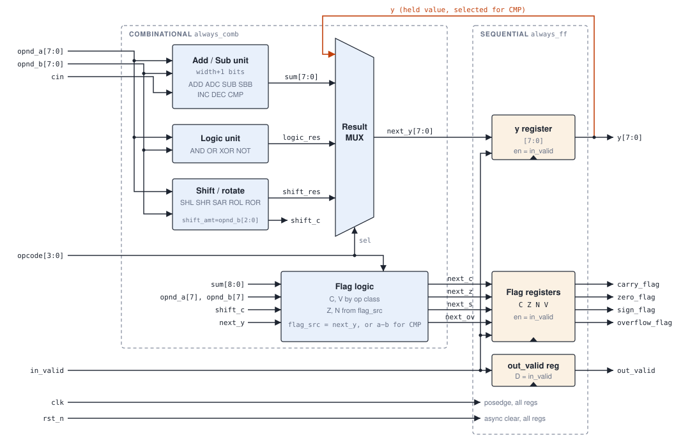

# 8-bit ALU — Design & Verification (SystemVerilog)

A registered, parameterised 8-bit ALU with 16 operations, x86-style status flags, single-cycle latency and a valid handshake. It's written in synthesizable SystemVerilog, verified with a self-checking directed testbench, and synthesised and implemented in Vivado on an Artix-7.

**Highlights**

- 16 operations: arithmetic with carry/borrow chaining, logic, shifts and rotates, and a non-destructive compare
- 4 flags: Carry, Zero, Negative, Overflow
- Registered outputs, 1-cycle latency, `in_valid` / `out_valid` handshake, asynchronous active-low reset
- Self-checking testbench: **21/21 directed vectors pass**
- Vivado implementation: **173 LUTs, 13 FFs (core)**, timing met at 100 MHz, **estimated Fmax ≈ 161 MHz**



## Repository layout

```
rtl/
  alu_pkg.sv            opcode enum (opcode_t)
  alu.sv                ALU core
  alu_top.sv            timing wrapper: registers inputs for reg-to-reg paths
tb/
  tb_alu.sv             self-checking directed testbench
constraints/
  alu_constraints.xdc   100 MHz clock constraint
docs/
  spec.md               design specification (source of truth)
  results.md            simulation, utilisation and timing results
  block_diagram.svg
```

## Interface

| Port | Dir | Width | Description |
| --- | --- | --- | --- |
| `clk` | in | 1 | Rising-edge clock |
| `rst_n` | in | 1 | Asynchronous active-low reset |
| `in_valid` | in | 1 | Operation present this cycle |
| `opcode` | in | 4 | Operation select |
| `opnd_a`, `opnd_b` | in | 8 | Operands (`opnd_b[2:0]` is the shift amount) |
| `cin` | in | 1 | Carry-in (ADC) / borrow-in (SBB) |
| `y` | out | 8 | Result |
| `out_valid` | out | 1 | New result available |
| `carry_flag`, `zero_flag`, `sign_flag`, `overflow_flag` | out | 1 each | C, Z, N, V |

## Operations

| Code | Op | Result | Code | Op | Result |
| --- | --- | --- | --- | --- | --- |
| 0000 | ADD | a + b | 1000 | XOR | a ^ b |
| 0001 | ADC | a + b + cin | 1001 | NOT | ~a |
| 0010 | SUB | a − b | 1010 | SHL | a << sh |
| 0011 | SBB | a − b − cin | 1011 | SHR | a >> sh (logical) |
| 0100 | INC | a + 1 | 1100 | SAR | a >>> sh (arithmetic) |
| 0101 | DEC | a − 1 | 1101 | ROL | rotate left |
| 0110 | AND | a & b | 1110 | ROR | rotate right |
| 0111 | OR | a \| b | 1111 | CMP | flags from a − b; `y` unchanged |

C uses the borrow convention: after a subtraction, C = 1 means a borrow occurred. That lets SUB followed by SBB chain multi-byte subtraction. The full per-operation flag rules are in [docs/spec.md](docs/spec.md).

## Design notes

- **Single combinational block.** Each operation's result and flags are computed in one `always_comb` with a `unique case` on `opcode_t`. Every intermediate signal gets a default assignment at the top of the block, so no latches are inferred.
- **Flags from a shared source.** Z and N come from `flag_src`, which is the result for most operations and the subtraction result for CMP. That lets CMP update the flags while `y` keeps its old value.
- **Hold on idle.** `out_valid` follows `in_valid` every cycle. `y` and the flags only load when `in_valid = 1`, which synthesises as a clock-enable on the output registers.
- **Parameterised.** The shift-amount width is derived as `$clog2(width)`.

## Verification

`tb/tb_alu.sv` is a self-checking directed testbench built from three tasks:

- `drive_op(op, a, b, cin)` applies an operation on the falling edge, so inputs are stable well before the next rising edge.
- `check_result(id, y, c, z, n, v)` compares every output against the expected values with `===` and counts passes and failures.
- `idle(n)` drops `in_valid` for `n` cycles.

The 21 vectors (listed in [spec.md §5](docs/spec.md#5-reference-vectors)) target corner cases:

- Signed overflow in both directions for ADD, SUB, INC and DEC
- Carry/borrow out, plus carry-in and borrow-in for ADC and SBB
- Zero results
- Shift amounts of 0 and 7
- Upper bits of `opnd_b` ignored for shifts
- Sign fill for SAR
- Rotate wraparound
- CMP leaving `y` untouched while updating flags

**Bug found by the testbench:** the first version of the overflow logic took the sign bits through a slice that evaluated bit 0 instead of bit 7. The ADD overflow vectors failed with `V = 1` where 0 was expected, which pointed straight at the expression. The same fix was then applied to ADC, SUB and SBB, and vector 21 was added as a regression test for SBB.

## Results

Vivado 2025.1, xc7a50tcpg236-1, 10 ns clock, top = `alu_top`.

| Metric | Value |
| --- | --- |
| LUTs (ALU core) | 173 |
| FFs (ALU core / total with wrapper) | 13 / 35 |
| WNS / WHS | +3.798 ns / +0.315 ns |
| Estimated Fmax | ≈ 161 MHz |

The critical path starts at the shift amount (`opnd_b[1]`, fanout 44), goes through the barrel shifter and result mux, and ends at `sign_flag`. Arithmetic is not the bottleneck because `+` and `−` use the FPGA's dedicated carry chain. About 63% of the path delay is routing. Full tables are in [docs/results.md](docs/results.md).

## How to run

**Vivado GUI**

1. Create an RTL project. Add `rtl/alu_pkg.sv`, `rtl/alu.sv` and `rtl/alu_top.sv` as design sources, `tb/tb_alu.sv` as a simulation source, and `constraints/alu_constraints.xdc` as a constraint.
2. Make sure `alu_pkg.sv` is first in the compile order.
3. Run Behavioral Simulation with `tb_alu` as the simulation top. The console prints PASS/FAIL per vector and a summary.
4. Set `alu_top` as the synthesis top. Run Synthesis and Implementation, then open the Utilization and Timing Summary reports.

**xsim from the command line**

```sh
xvlog -sv rtl/alu_pkg.sv rtl/alu.sv tb/tb_alu.sv
xelab tb_alu -s tb_alu_sim
xsim tb_alu_sim -runall
```

## Future work

- Reference model in the testbench, plus constrained-random stimulus checked against it
- Functional coverage: hit counters per opcode and flag, then covergroups
- Vivado code coverage (line, branch, condition)
- Bug-injection runs to measure how effective the testbench is
- SystemVerilog Assertions for the handshake and reset behaviour
- A UVM environment

## Tools

SystemVerilog (IEEE 1800), Xilinx Vivado 2025.1 (xsim, synthesis, implementation).
